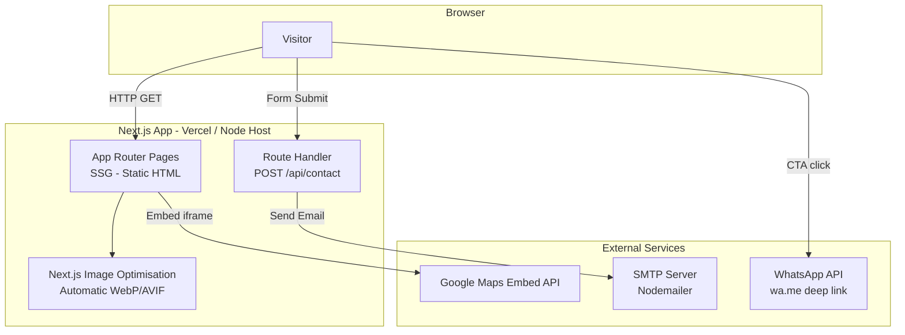

# Design Document

## Greenlife Daily Premium Vehicle Rental Website

---

## Overview

The Greenlife Daily website is a mobile-first, lead-generation marketing site for a premium vehicle rental company operating in South Africa. Its primary purpose is to convert visitors into enquiries and bookings via WhatsApp and a contact form. The site is static-content-heavy with a single dynamic feature (the quote form submission), making a statically generated architecture the optimal choice.

The design prioritises:

- **Conversion**: Persistent WhatsApp and quote CTAs on every page
- **Performance**: Static generation + Next.js Image optimisation to meet Core Web Vitals targets (LCP ≤ 2.5s, CLS ≤ 0.1, PageSpeed ≥ 80 on mobile)
- **SEO**: Server-rendered HTML with structured data, clean URL slugs, sitemap, and robots.txt
- **Accessibility**: WCAG 2.1 AA compliance throughout
- **Premium feel**: Tailwind CSS utility classes with a green/white/charcoal brand palette, smooth transitions, and high-quality photography

### Key Design Decisions

| Decision | Choice | Rationale |
|---|---|---|
| Framework | Next.js 14 (App Router) | SSG/SSR, built-in image optimisation, metadata API, sitemap/robots support, large ecosystem |
| Styling | Tailwind CSS v3 | Utility-first, mobile-first responsive modifiers, no runtime overhead |
| Form emails | Nodemailer via Next.js Route Handler | Self-hosted SMTP, no third-party subscription required for simple transactional email |
| Spam protection | Honeypot field + optional reCAPTCHA v3 | Low friction for genuine users, effective bot filtering |
| Vehicle/service data | TypeScript data files (co-located with `src/data/`) | No CMS required for a curated fleet; content updates are simple code changes |
| Deployment | Vercel (recommended) or any Node-compatible host | Zero-config Next.js deployment, global CDN, HTTPS by default |

---

## Architecture

The site follows a **Jamstack-style static generation** approach. All pages are pre-rendered at build time; only the quote form submission invokes a server-side Route Handler.



### Page Rendering Strategy

| Page | Strategy | Reason |
|---|---|---|
| `/` (Home) | SSG | Fully static content |
| `/services` | SSG | Fully static content |
| `/vehicles` | SSG | Vehicle list is static; client-side filter on top |
| `/about` | SSG | Fully static content |
| `/contact` | SSG | Form UI is static; submission uses Route Handler |
| `/api/contact` | Route Handler (server) | Processes form POST, sends email |

---

## Components and Interfaces

### Component Hierarchy

```
src/
├── app/
│   ├── layout.tsx                  # Root layout: Nav, Footer, WhatsApp button
│   ├── page.tsx                    # Home page
│   ├── services/
│   │   └── page.tsx                # Services page
│   ├── vehicles/
│   │   └── page.tsx                # Vehicles page
│   ├── about/
│   │   └── page.tsx                # About page
│   ├── contact/
│   │   └── page.tsx                # Contact page
│   ├── api/
│   │   └── contact/
│   │       └── route.ts            # POST handler for quote form
│   ├── sitemap.ts                  # Dynamic sitemap.xml
│   └── robots.ts                  # robots.txt
├── components/
│   ├── layout/
│   │   ├── Navbar.tsx
│   │   ├── Footer.tsx
│   │   └── WhatsAppButton.tsx
│   ├── home/
│   │   ├── HeroSection.tsx
│   │   ├── FeaturedVehiclesSection.tsx
│   │   ├── ServicesOverview.tsx
│   │   ├── WhyChooseSection.tsx
│   │   ├── TestimonialsSection.tsx
│   │   ├── FaqSection.tsx
│   │   └── FinalCtaSection.tsx
│   ├── shared/
│   │   ├── VehicleCard.tsx
│   │   ├── ServiceCard.tsx
│   │   ├── QuoteForm.tsx
│   │   ├── StickyQuoteCta.tsx
│   │   └── ClickToCallButton.tsx
│   └── vehicles/
│       └── VehicleFilter.tsx
├── data/
│   ├── vehicles.ts
│   ├── services.ts
│   ├── testimonials.ts
│   ├── faqs.ts
│   └── company.ts
├── lib/
│   ├── email.ts                    # Nodemailer helper
│   └── validation.ts               # Zod schemas
└── styles/
    └── globals.css
```

### Core Component Interfaces

#### VehicleCard

```typescript
interface Vehicle {
  id: string;
  name: string;
  category: ServiceCategory;
  passengerCapacity: number;
  transmission: 'Automatic' | 'Manual';
  fuelType: 'Petrol' | 'Diesel' | 'Hybrid' | 'Electric';
  images: string[];          // paths relative to /public/images/vehicles/
  altText: string;
  featured: boolean;
}

interface VehicleCardProps {
  vehicle: Vehicle;
  onEnquire?: (vehicleName: string) => void; // pre-populates QuoteForm
}
```

#### ServiceCard

```typescript
type ServiceCategory =
  | 'Luxury Vehicle Hire'
  | 'Matric Dance Transport'
  | 'Wedding Vehicle Hire'
  | 'Executive Transport'
  | 'Airport Transfers'
  | 'Corporate Rentals'
  | 'VIP Escort Services'
  | 'Music Video Vehicle Hire'
  | 'TV & Film Production Vehicle Hire';

interface Service {
  id: string;
  category: ServiceCategory;
  slug: string;             // e.g. 'luxury-vehicle-hire'
  icon: string;             // SVG component name or path
  title: string;
  shortDescription: string; // ≤ 30 words
  fullDescription: string;
  useCases: string[];
}

interface ServiceCardProps {
  service: Service;
  variant: 'overview' | 'full';
}
```

#### QuoteForm

```typescript
interface QuoteFormValues {
  fullName: string;
  phoneNumber: string;
  emailAddress: string;
  serviceRequired: ServiceCategory | '';
  rentalDate: string;       // ISO date string
  message: string;
  // Honeypot — must remain empty for valid submissions
  _gotcha?: string;
}

interface QuoteFormProps {
  prefilledVehicle?: string;
  prefilledService?: ServiceCategory;
}
```

#### Testimonial

```typescript
interface Testimonial {
  id: string;
  reviewerName: string;
  starRating: 1 | 2 | 3 | 4 | 5;
  reviewText: string;
}
```

#### FAQ Item

```typescript
interface FaqItem {
  id: string;
  question: string;
  answer: string;
}
```

### Navigation Component Behaviour

- Desktop (>768px): Horizontal nav bar with links; sticky `Request a Quote` button in nav bar
- Mobile (≤768px): Hamburger icon toggles a slide-in drawer with all nav links; click-to-call button visible; sticky quote CTA floats above footer
- `aria-expanded` and `aria-controls` attributes manage hamburger/drawer state for screen readers
- Active page link receives `aria-current="page"`

### Vehicles Page Filter

The filter is a client-side `VehicleFilter` component rendered via `'use client'`. It stores the active category in `localStorage` (key: `greenlife_vehicle_filter`) to persist across sessions (Requirement 9.5).

On mount, the component reads `localStorage` and sets initial state. If `localStorage` is unavailable (private browsing) the filter defaults to "All".

If the JavaScript filter fails at runtime (Requirement 9.7), a `<noscript>` fallback and an error boundary redirect to `/vehicles?category=<value>` which the page handles via `searchParams` server-side, triggering a full page reload.

---

## Data Models

### Vehicle Data Structure (src/data/vehicles.ts)

```typescript
export const vehicles: Vehicle[] = [
  {
    id: 'mercedes-s-class',
    name: 'Mercedes-Benz S-Class',
    category: 'Luxury Vehicle Hire',
    passengerCapacity: 4,
    transmission: 'Automatic',
    fuelType: 'Petrol',
    images: ['/images/vehicles/mercedes-s-class-1.webp'],
    altText: 'Silver Mercedes-Benz S-Class luxury sedan, side profile',
    featured: true,
  },
  // … 5–7 more vehicles
];

export const featuredVehicles = vehicles.filter(v => v.featured);
```

### Form Submission Payload

```typescript
// POSTed to /api/contact as JSON
interface ContactPayload extends QuoteFormValues {
  submittedAt: string; // ISO timestamp added server-side
}
```

### Email Template Variables

```
To: [GREENLIFE_EMAIL from env]
Subject: New Quote Request – {serviceRequired} – {fullName}
Body: Name, Phone, Email, Service, Rental Date, Message, Timestamp
```

### Environment Variables

```
SMTP_HOST=
SMTP_PORT=
SMTP_USER=
SMTP_PASS=
SMTP_FROM=
GREENLIFE_EMAIL=
NEXT_PUBLIC_WHATSAPP_NUMBER=   # e.g. 27XXXXXXXXX
NEXT_PUBLIC_PHONE_NUMBER=
NEXT_PUBLIC_GOOGLE_MAPS_EMBED_URL=
RECAPTCHA_SECRET_KEY=           # optional, if reCAPTCHA enabled
NEXT_PUBLIC_RECAPTCHA_SITE_KEY= # optional
```

---

## Correctness Properties

*A property is a characteristic or behavior that should hold true across all valid executions of a system — essentially, a formal statement about what the system should do. Properties serve as the bridge between human-readable specifications and machine-verifiable correctness guarantees.*

This feature is a marketing website with UI rendering, static content, and a simple form submission. Full property-based testing (PBT) is **not broadly applicable** across all features. However, several universal rules hold across variable inputs — specifically around responsive layout, data rendering completeness, form validation, and accessibility — and these are expressed as properties below. For static/structural content checks, example-based tests are the appropriate tool.

The recommended PBT library is **fast-check** (TypeScript/JavaScript), which integrates well with Vitest.

### Property 1: Vehicle Card renders all required fields

*For any* vehicle in the vehicles dataset, rendering its `VehicleCard` component should produce HTML that contains the vehicle's name, passenger capacity, transmission type, fuel type, and category.

**Validates: Requirements 2.2, 9.2**

---

### Property 2: Vehicle Card CTA pre-populates form with vehicle name

*For any* vehicle, activating the enquiry CTA on its `VehicleCard` should set the `QuoteForm`'s vehicle/subject field to exactly that vehicle's name, regardless of which other vehicles exist in the dataset.

**Validates: Requirements 2.3, 9.3**

---

### Property 3: Service section renders all required elements

*For any* service in the services dataset, its rendered section on the Services Page must contain a heading, a non-empty description, at least one use case, and an enquiry CTA link.

**Validates: Requirements 8.3**

---

### Property 4: Service CTA pre-populates form with service category

*For any* service in the services dataset, activating its enquiry CTA should set the `QuoteForm`'s `serviceRequired` field to exactly that service's `ServiceCategory` value.

**Validates: Requirements 8.4**

---

### Property 5: Vehicle filter shows only matching cards

*For any* valid `ServiceCategory` value used as a filter selection on the Vehicles Page, every `VehicleCard` displayed must have a `category` that equals the selected filter value, and no card from a different category must be rendered.

**Validates: Requirements 9.6**

---

### Property 6: Form validation rejects any subset of missing required fields

*For any* submission of the `QuoteForm` where one or more required fields (`fullName`, `phoneNumber`, `emailAddress`, `serviceRequired`, `rentalDate`) are left empty, the form must not be submitted and must display an inline validation error for each empty field.

**Validates: Requirements 11.4**

---

### Property 7: Every image element has a non-empty alt attribute

*For any* rendered page in the website, every `` element (and Next.js `<Image>` component) must have an `alt` attribute that is present and non-empty.

**Validates: Requirements 14.7, 16.1**

---

### Property 8: Every form field has an associated label

*For any* form rendered on the website, every `<input>`, `<select>`, and `<textarea>` element must be associated with a visible `<label>` element via matching `for`/`id` attributes or `aria-labelledby`.

**Validates: Requirements 16.4**

---

### Property 9: FAQ accordion open/close round-trip

*For any* FAQ item, opening and then closing it should return the item to its original closed state — i.e., the answer text should not be visible after the second activation.

**Validates: Requirements 6.4**

---

### Property 10: Service card in overview renders icon, title, and description

*For any* service in the services dataset, its `ServiceCard` in `variant="overview"` mode must render an icon element, a title, and a description of at most 30 words.

**Validates: Requirements 3.2**

---

### Property 11: Hamburger menu reveals all navigation links on mobile

*For any* viewport width at or below 768px, after activating the hamburger icon, all five navigation links (Home, Services, Vehicles, About, Contact) must become visible in the DOM.

**Validates: Requirements 13.3**

---

## Property Reflection

Reviewing the properties above for redundancy:

- **Properties 2 and 4** both test CTA pre-population but for different domains (vehicles vs. services) — kept separate because they test different components and data.
- **Properties 7 and 8** both test accessibility attributes but on different element types (`alt` vs. `label`) — kept separate.
- **Properties 1 and 3** both test "required fields rendered" but on different components (`VehicleCard` vs. service section) — kept separate.
- No further consolidation is warranted; all properties provide unique validation value.

---

## Error Handling

### Quote Form Submission Errors

| Scenario | Handling |
|---|---|
| Client-side validation failure | Inline error messages per field; form not submitted; `aria-invalid` set on fields; focus moved to first error |
| Network error during POST | Display persistent banner: "Something went wrong. Please try again or contact us via WhatsApp." with WhatsApp deep link |
| Server error (5xx) from Route Handler | Same user-facing message as network error; error logged server-side |
| SMTP failure | Route Handler returns 500; client shows error banner; error logged with timestamp and payload (excluding PII beyond email) |
| Honeypot field populated (bot) | Route Handler silently returns 200 (so bots think success) but does not send email |

### Google Maps Embed Failure

The `<iframe>` embed is wrapped in a `<noscript>`-compatible container. If the iframe fires an `error` event or `postMessage` indicates load failure, a static fallback `` (pre-generated map screenshot, served as WebP) replaces the iframe (Requirement 11.9).

### Vehicle Filter Failure

If the JavaScript `VehicleFilter` component throws an unhandled error, a React error boundary catches it and falls back to full-page reload using the URL query string (`/vehicles?category=<value>`) so the page server-renders the filtered subset (Requirement 9.7).

### Navigation / Routing

- All pages are statically generated; 404 errors are handled by Next.js default 404 page (customisable with `app/not-found.tsx`)
- The robots.txt and sitemap.xml are auto-generated at build time via Next.js metadata APIs

---

## Testing Strategy

### Overview

The testing approach is **dual-layer**:

1. **Unit / component tests** using **Vitest** + **React Testing Library** — verify specific rendered output, example interactions, and edge cases
2. **Property-based tests** using **fast-check** + **Vitest** — verify the universal properties defined in the Correctness Properties section above

Integration/smoke tests verify SEO metadata, form submission pipeline, and accessibility at the page level.

### Unit Tests

Focus areas:

- `QuoteForm`: validation logic (required fields, phone format, date format), submission success/error states
- `VehicleCard`: correct rendering of all fields, CTA click handler
- `ServiceCard`: icon/title/description rendering for both variants
- `FaqSection`: accordion open/close state transitions
- `TestimonialsSection`: carousel navigation, timing
- `VehicleFilter`: localStorage read/write, filter application, error boundary fallback
- `Navbar`: desktop vs. mobile rendering, hamburger toggle
- Route Handler (`/api/contact`): validates payload, rejects honeypot, calls Nodemailer, returns correct HTTP codes

### Property-Based Tests (fast-check)

Each property-based test must run a minimum of **100 iterations**. Tag format: `// Feature: greenlife-daily-website, Property N: <property_text>`

| Test | Arbitraries Used | Validates |
|---|---|---|
| Vehicle Card field completeness | `fc.constantFrom(...vehicles)` | Property 1 |
| Vehicle Card CTA pre-population | `fc.constantFrom(...vehicles)` | Property 2 |
| Service section field completeness | `fc.constantFrom(...services)` | Property 3 |
| Service CTA pre-population | `fc.constantFrom(...services)` | Property 4 |
| Vehicle filter correctness | `fc.constantFrom(...serviceCategories)` | Property 5 |
| Form validation rejects missing fields | `fc.subarray(requiredFields, {minLength: 1})` | Property 6 |
| All images have alt attributes | `fc.constantFrom(...allPagePaths)` | Property 7 |
| All form fields have labels | `fc.constantFrom(...formComponents)` | Property 8 |
| FAQ accordion round-trip | `fc.constantFrom(...faqItems)` | Property 9 |
| Service overview card completeness | `fc.constantFrom(...services)` | Property 10 |
| Hamburger reveals all nav links | `fc.integer({min: 320, max: 768})` | Property 11 |

### Smoke / Integration Tests

- **SEO metadata**: Assert each page exports a `metadata` object with `title` (50–60 chars), `description` (150–160 chars), and all four OG tags
- **Schema markup**: Assert Home Page HTML contains valid JSON-LD `Organization` and `LocalBusiness` objects
- **robots.txt**: Assert `/robots.txt` returns valid content
- **sitemap.xml**: Assert `/sitemap.xml` lists all 5 public pages
- **HTTPS**: All asset URLs use `https://` in production build
- **Form submission pipeline**: Mock Nodemailer, POST valid payload to `/api/contact`, assert 200 response and mailer called once
- **Honeypot**: POST payload with `_gotcha` populated, assert 200 but mailer NOT called
- **Google Maps fallback**: Mock iframe error event, assert static fallback image is displayed

### Accessibility Checks

- **axe-core** (via `@axe-core/react` or `jest-axe`) on every page component — no violations at WCAG 2.1 AA level
- Keyboard navigation tests: Tab through all interactive elements on each page, assert focus indicators visible
- Colour contrast: Verified at design time using Tailwind's configured palette (green-600 on white = 4.83:1 ✓)

### Performance Validation

Performance targets are validated via **Lighthouse CI** in the build pipeline:

```yaml
# .lighthouserc.js
module.exports = {
  ci: {
    assert: {
      assertions: {
        'categories:performance': ['error', { minScore: 0.8 }],
        'largest-contentful-paint': ['error', { maxNumericValue: 2500 }],
        'cumulative-layout-shift': ['error', { maxNumericValue: 0.1 }],
      },
    },
  },
};
```
